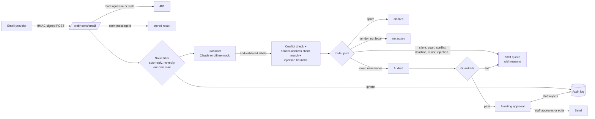

# law-intake-agent

Human-in-the-loop AI email intake for a **fictional** law office, Hale & Ortiz Law PLLC.

Inbound email arrives as a **signed, idempotent webhook**. Claude **labels** each message (category, practice area, urgency, parties, minors, injection attempts) as validated structured output. **Deterministic, unit-tested code** then runs the conflict check, decides the route and checks any AI-written reply against hard guardrails. The AI only drafts replies for clean, routine, in-scope new matters, and **nothing is sent until a person approves it**. Everything else goes straight to a person with the reasons attached.

> All names, clients, matters and emails here are invented. The design mirrors an email lead pipeline I built and run in production for a service business: signed webhooks, a retry-or-fail status contract, idempotency per message, a dry-run mode, an LLM classifier with a replay eval, client matching by sender address only, and AI-drafted replies held for a person's approval. This repo rebuilds those patterns from scratch for a different industry; none of the production code, prompts or data are in it. Nothing here is legal advice or a compliance claim.



## Design decisions

| Decision | Why |
|---|---|
| **The model labels; code decides.** Claude returns an `IntakeClassification`. `route()` is a pure function over those labels plus deterministic checks. | Routing rules are policy. Keeping them in code makes them reviewable, testable and immune to a persuasive email. |
| **AI drafts only for clean, routine, in-scope new matters.** Conflicts, emergencies, deadlines within about 60 days, minors, out-of-scope areas, low confidence and suspected injection all go to a person. | The cost of a person reading one more email is small. The cost of an AI replying to a detained client's family is not. |
| **No send without approval.** Drafts sit in `awaiting_approval`. The only path to the mailer is `POST /staff/drafts/:id/approve`, and a draft can be approved once. | Human in the loop is enforced by the code path, not by a prompt. |
| **Deterministic guardrails on AI text.** Blocks money and fees, outcome promises, legal advice, "we represent you" and em or en dashes. A failed draft is never shown to staff; the email is handed off instead. Signature and disclaimer are added by code. | A model can be talked into anything once. A regex cannot. False positives cost a minute; false negatives cost a bar complaint. |
| **Client identity comes from the sender address only.** An email *saying* "I am a current client" from an unknown address is routed as `unverified_client_claim` and never linked to a matter. | The body is attacker-controlled. Treating it as identity is how case files get mailed to strangers. |
| **Prompt injection is detected twice.** The model's own `injectionSuspected` flag OR a regex heuristic triggers a handoff, and the flag rides along on every handoff reason list. | The model reading the attack is not the best judge of whether it was attacked. In the eval, one injection fools the classifier into the wrong category and is still caught. |
| **Deterministic conflict check.** The model extracts names and roles; code compares normalized names against client and adverse-party lists in the right direction only. | Suing the company the firm already sues is fine. Representing that company is not. That logic should not be probabilistic. |
| **Signed webhooks.** HMAC-SHA256 over `timestamp.rawBody`, constant-time compare, 5 minute replay window. | Anyone can POST to a URL. Only the provider can sign. |
| **Idempotent by `messageId`, with a clear status contract.** 2xx means done (duplicates return the stored result), 4xx means permanent, 503 means retry later. After 3 failed attempts the message is dead-lettered and answered 422. Concurrent deliveries share one run. | Providers retry. Without idempotency a retry is a second AI reply; without a dead letter a poison message retries forever. |
| **Dry run.** `x-dry-run: 1` classifies and routes, then writes, drafts and sends nothing. | Safe way to test a new prompt or model against live traffic shapes. |
| **Loop prevention.** Outbound mail carries an `x-intake-origin` header and the noise filter drops it, along with auto-replies and no-reply senders, before any model call. | Two autoresponders replying to each other is a classic, expensive bug. |
| **Everything is audited** with the model id and a hash of both prompts. | "Who approved this, and which prompt wrote it?" has an answer. |

## Run it

```bash
npm install
npm test          # 20 tests, no API key needed
npm run eval      # offline eval with the keyword mock
npm start         # http://localhost:3001, prints a throwaway webhook secret and staff token

# With the real model
cp .env.example .env   # add ANTHROPIC_API_KEY
ANTHROPIC_API_KEY=sk-... npm run eval
```

Without `ANTHROPIC_API_KEY` the service uses `MockIntakeModel`, a deliberately simple keyword classifier that returns the same schema, so tests and CI run offline.

### Try it

```bash
export WEBHOOK_SECRET=<printed on startup> STAFF_TOKEN=<printed on startup>

npm run send -- pi-routine                      # clean new matter: AI draft, awaiting approval
npm run send -- injection-ignore-instructions   # handed off: injection_suspected
npm run send -- client-claim-unknown-address    # handed off: unverified_client_claim
npm run send -- emergency-detained --dry-run    # decision only, nothing stored

curl -s localhost:3001/staff/queue -H "authorization: Bearer $STAFF_TOKEN"
curl -s -X POST localhost:3001/staff/drafts/<draftId>/approve \
  -H "authorization: Bearer $STAFF_TOKEN" -H 'content-type: application/json' \
  -d '{"approvedBy":"paralegal.kim"}'
curl -s localhost:3001/staff/outbox -H "authorization: Bearer $STAFF_TOKEN"
```

## API

| Method | Path | Purpose |
|---|---|---|
| `POST` | `/webhooks/email` | Signed inbound email (`x-intake-timestamp`, `x-intake-signature: sha256=<hex>`). Optional `x-dry-run: 1`. |
| `GET` | `/staff/queue` | Drafts awaiting approval, and handoffs sorted by priority (emergency first). |
| `GET` | `/staff/messages/:messageId` | Full record, draft and audit trail for one email. |
| `POST` | `/staff/drafts/:id/approve` | `{ approvedBy, body? }`. Sends the draft, or the staff member's edited text. |
| `POST` | `/staff/drafts/:id/reject` | `{ rejectedBy, reason }`. |
| `GET` | `/staff/dead-letters` | Messages that failed 3 times. |
| `GET` | `/staff/outbox` | Demo mailer outbox (what would have been sent). |

## Evals

`evals/fixtures.json` holds 25 synthetic emails: routine matters in each practice area, deadlines, an emergency, a hurt child, two conflicts of interest, an out-of-scope request, a vague one, two prompt injections, a real client, a fake client, a court notice, opposing counsel, vendor spam, a scam, an off-topic question and three kinds of noise. `evals/guardrail-cases.json` holds drafts that must be blocked (by a named rule) and drafts that must pass.

`npm run eval` runs every email through the real pipeline and writes `evals/report.<model>.md` with category accuracy, route accuracy, handoff-reason recall, a confusion matrix and the guardrail block rate. **CI fails if any email that must go to a person gets an AI draft**, or if any guardrail case is mishandled.

**About the numbers:** the offline mock's rules were written against these fixtures, so its score only proves the harness works. Model quality is measured by running the same command with `ANTHROPIC_API_KEY` set.

## Layout

```
src/
  domain/   schema.ts (zod), routing.ts (pure), guardrails.ts, conflicts.ts,
            injection.ts, noise.ts, firm.ts (synthetic data)
  ai/       prompts.ts (+ version hash), claude.ts, mock.ts, llm.ts
  pipeline.ts   one email start to finish, plus approve and reject
  webhook.ts    HMAC signing and verification
  app.ts        Hono routes, status contract, idempotency, dead letters
  store.ts      records, drafts, audit log (memory + optional JSONL)
  mailer.ts     outbox mailer with loop-prevention header
evals/      fixtures, guardrail cases, runner
scripts/    send-sample.ts (signed webhook sender)
tests/      node:test
```

## Production notes

This is a focused demo. A production version adds Postgres for records and the audit log, SSO with per-person identity on staff routes, the firm's case management system as the source for clients and adverse parties, fuzzy name matching with a human confirm step for near misses, attachment handling, a queue (with the 503 contract above) between the webhook and the model, tracing on model calls, and a periodic review of handoff reasons to tune the routing rules.

## License

MIT
